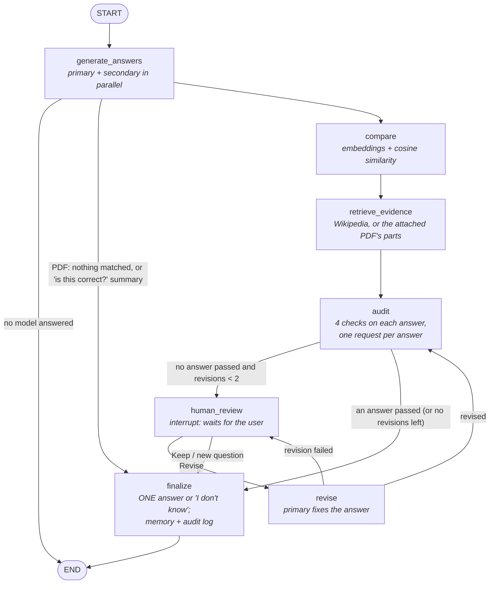

<p align="center"></p>

# VerdictAi

[](https://github.com/tamarkilasonia/VerdictAI/actions/workflows/tests.yml)

**Try it online: [verdic-t-ai.streamlit.app](https://verdic-t-ai.streamlit.app)**

**A chat app that does not blindly trust one LLM.**

VerdictAi asks two language models the same question, audits **both** answers for
**hallucination, bias, toxicity and intent alignment** against **real Wikipedia
evidence**, and shows you **one answer: the one that passed the check**. If neither
passed, it shows **Wikipedia's own text** instead, or says honestly that it does not
know, and you can ask for a **corrected answer** built from the evidence. It works in
**English**.

## What it does

- **Two models answer in parallel**, and their agreement is measured with embeddings
- **An auditor checks both answers** against Wikipedia passages: hallucination, bias,
  toxicity and intent alignment, in one request per answer
- **Only an answer that passed is shown**; otherwise Wikipedia's own text or an honest
  "I don't know"
- **Human-in-the-loop revision:** when no answer passed, you can ask for a corrected
  answer built from the evidence, which is audited again
- **Answers from your own PDF:** attach a file and both models answer only from it, citing
  the page
- **Fact check of the PDF:** right after a file is attached, its claims are checked
  against Wikipedia and shown in a table (confirmed / contradicted / can't be checked);
  answers that repeat a wrong claim get a warning with the correct fact
- **Audit trail:** every question is logged to `logs/audit_log.jsonl`

Step by step: [docs/how-it-works.md](docs/how-it-works.md)

## Results at a glance

| What | Result |
|---|---|
| Audit quality (13 hand-written cases, 52 verdicts) | 50 / 52 correct |
| PDF fact check (3 test files, 16 wrong claims) | 15 caught, 3 false alarms ([`eval/`](eval/README.md)) |
| Time per question (all on Groq) | about 4 s |
| Tests | 167, run by GitHub Actions on every push |

Details and how they were measured: [docs/evaluation.md](docs/evaluation.md)

## Workflow (LangGraph)



A **sequential pipeline** with **parallel** steps (two answers, two audits). Routing is
done by code; the only decision-maker is the user (human-in-the-loop). State, memory and
the interrupt are explained in [docs/how-it-works.md](docs/how-it-works.md#workflow-details).

## Quick start

Requirements: Python 3.12, an internet connection and free API keys (Groq; optionally
Gemini).

```bash
# 1. Create a virtual environment and install the dependencies
python3.12 -m venv .venv
source .venv/bin/activate
pip install -r requirements.txt     # includes PyTorch, so it takes a few minutes

# 2. Create your settings file and paste your keys into it
cp .env.example .env                # PRIMARY_API_KEY, SECONDARY_API_KEY

# 3. Run
streamlit run app.py                # opens http://localhost:8501

# Tests (no keys, internet or PyTorch needed)
pytest -q
```

The first question downloads the embedding model (~470 MB). To run everything on Groq
with one key, and for all settings and model choices, see
[docs/configuration.md](docs/configuration.md).

## Deployment

**Online: [verdic-t-ai.streamlit.app](https://verdic-t-ai.streamlit.app)**, on Streamlit
Community Cloud, deployed from this repository (`main`, `app.py`, Python 3.12); every push
to `main` redeploys it. The keys are in Streamlit's Secrets, not in the repository, and the
online version runs entirely on Groq. After a while without visitors it sleeps, and the
first visit takes about a minute. Details: [docs/deployment.md](docs/deployment.md)

## Project structure

```
app.py          Streamlit UI only (chat, audit panel, header, review buttons)
ui.py           Look and feel: dark violet theme, CSS, logo, line icons, small HTML pieces
assets/         The VerdictAi logo (full, and the "V" mark used as the tab icon)
graph.py        LangGraph state, nodes, routing, checkpointer
models.py       Chat-model factory configured from .env (+ retry with backoff)
answers.py      Answer and revision prompts; asks both models in parallel
agreement.py    Embeddings + cosine similarity
retrieval.py    Wikipedia search, passage splitting, re-ranking
documents.py    Attached PDF: reading, page-numbered chunks, search, the prompt for the models
factcheck.py    Fact check of an attached PDF against Wikipedia: claims, batched audit, warnings, summary
auditor.py      The four checks: Pydantic schemas, prompts, parsing, verdicts
audit_log.py    JSONL audit trail
config.py       Settings loaded from .env
tests/          pytest tests
docs/           Detailed documentation (linked below)
eval/           Test PDFs with known mistakes, and the fact-check results
```

## Course concepts applied

| Feature | Concept | Lesson | Where |
|---|---|---|---|
| Two-model answers | Parallel agents | 2, 11 | `answers.ask_both` |
| Agreement check | Embeddings, cosine similarity | 5 | `agreement.py` |
| Conversation memory | Short-term memory, checkpointer, `thread_id`, history window | 3, 10 | `graph.py` (`MemorySaver`) |
| Four-check audit | LLM-as-a-judge, structured outputs (Pydantic, JSON schema), retries, parallel checks | 2, 11 | `auditor.py` |
| Grounded hallucination check | RAG: retrieval + re-ranking | 7–9 | `retrieval.py` |
| Answers from an attached PDF | RAG over a user document: chunking, embeddings, similarity search, grounded prompt with citations | 5, 7–9 | `documents.py` |
| Fact check of the PDF | Claim extraction, LLM-as-a-judge in batches, rate-limit handling, semantic matching with embeddings | 2, 5, 7–9, 11 | `factcheck.py` |
| Revise answer | Conditional routing, loops, human-in-the-loop `interrupt` | 10 | `graph.py`, `app.py` |
| Audit trail | Logging | 4 | `audit_log.py` |
| Workflow | LangGraph state graph | 10 | `graph.py` |

## Limitations and future work

- **Free tiers:** the auditor's daily Groq limit allows about 30 fully checked questions
  a day; a PDF fact check uses about 6% of it
- **Wikipedia only:** only English Wikipedia introductions are used as evidence, so recent
  events and niche details are often "can't be checked"
- **Memory lives in RAM:** conversations disappear when the server restarts
- **Next steps:** caching results, a per-user limit in the public app, Georgian support,
  sources beyond Wikipedia, preferring the main article, memory in a database

All limitations and the future work: [docs/limitations-and-future-work.md](docs/limitations-and-future-work.md)

## Documentation

| Document | Contents |
|---|---|
| [docs/how-it-works.md](docs/how-it-works.md) | Every step of a question, the PDF mode and the fact check in detail |
| [docs/deployment.md](docs/deployment.md) | Streamlit Cloud setup, the secrets used, the online models |
| [docs/configuration.md](docs/configuration.md) | AI services, model choices (measured), all `.env` settings |
| [docs/evaluation.md](docs/evaluation.md) | How reliable the audit is, end-to-end tests, what the unit tests cover |
| [eval/README.md](eval/README.md) | Test PDFs with known mistakes and the fact-check results |
| [docs/limitations-and-future-work.md](docs/limitations-and-future-work.md) | Known limitations and planned improvements |
