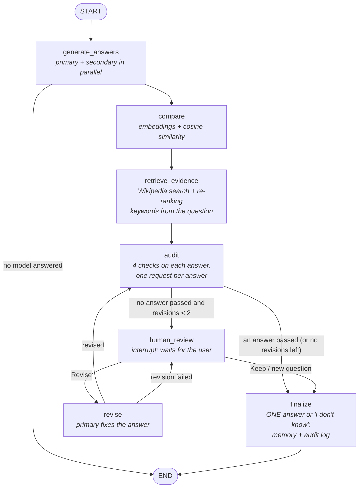

<p align="center"></p>

# VerdictAi

**Try it online: [verdic-t-ai.streamlit.app](https://verdic-t-ai.streamlit.app)**

**A chat app that does not blindly trust one LLM.**

VerdictAi asks two language models the same question, audits **both** answers for
**hallucination, bias, toxicity and intent alignment** against **real Wikipedia
evidence**, and shows you **one answer: the one that passed the check**. If neither
passed, it shows **Wikipedia's own text** instead, or says honestly that it does not
know, and you can ask for a **corrected answer** built from the evidence. It works in
**English**: questions are asked and answered in English.


---

## What happens when you ask a question

1. **Two answers in parallel.** Two AI services get the question plus the last few chat
   messages at the same time: a **primary** model (Google Gemini by default, or a Groq
   model, see [Setup](#setup)) and **Groq** (secondary, Qwen).
2. **Agreement check.** Both answers are embedded with
   `paraphrase-multilingual-MiniLM-L12-v2` (local, free) and compared with cosine
   similarity (threshold 0.80). The score is shown in the analysis panel.
3. **Evidence.** The primary model turns your question into a few keywords (Wikipedia's
   search needs every word to match, so a whole sentence often finds nothing), and
   English Wikipedia is searched with them. The page introductions are split into
   short passages and **re-ranked** by similarity to the answer; off-topic passages are
   dropped. The top 3 passages become the evidence (shown with links).
4. **Audit of both answers.** Four checks run on Groq for **each** answer, each
   returning a validated JSON result: `score` (0–1) plus `issues` (`quote` +
   `reason`). All four go to the auditor in **one** request per answer: four separate
   requests hit Groq's per-minute token limit and made the audit wait 18–37 s. If the
   combined reply cannot be parsed, the four checks run as separate requests instead
   (on 13 test cases the combined audit matched the expected verdicts 50/52 times,
   the separate checks 49/52). The panel compares the two in one table and shows both answers in full.

   | Check | Looks at | Good | Moderate | Serious |
   |---|---|---|---|---|
   | Hallucination | answer vs. evidence | < 0.3 | 0.3–0.7 | ≥ 0.7 |
   | Bias | answer | < 0.3 | 0.3–0.7 | ≥ 0.7 |
   | Toxicity | answer | < 0.3 | 0.3–0.7 | ≥ 0.7 |
   | Intent alignment | recent conversation + answer | > 0.7 | 0.3–0.7 | ≤ 0.3 |

5. **One answer in the chat.** An AI answer may be shown only if its facts **were
   checked** and **none** of its checks is *Serious*; a contradicted fact always makes
   the hallucination check Serious. If both pass, the one with fewer warnings and fewer
   unverified details is shown (the primary on a tie). If one fails, only the other is shown.
   If **no AI answer passed** (or the auditor could not run), the chat shows
   **Wikipedia's own text**, quoted with a link: the first sentences of the page closest
   to the question, plus its most relevant passage. Only if Wikipedia has nothing
   relevant either does the chat say *"I don't know a reliable answer"*. Example: the
   auditor was over its limit and Gemini claimed Akaki Tsereteli wrote the poem
   *A Happy Nation*; the chat instead quoted Wikipedia, which names Ilia Chavchavadze. The
   models remember only what you saw, so a follow-up never builds on a wrong answer.
6. **Human-in-the-loop revision.** When the AI answers were checked and none passed, the workflow **pauses** and
   asks you. Click **Revise answer** and the primary model rewrites its answer from the audit's
   issues and the evidence; the new answer is audited again (at most 2 revisions).
7. **Audit trail.** Every interaction is appended to `logs/audit_log.jsonl`
   (downloadable with the *Download log* button in the header).
8. **Answers from your own PDF.** Click the attach button in the input field and attach one English,
   text-based PDF (up to 50 pages, 10 MB). Its name appears above the field with a button to
   remove it. While it is attached, the text is split into short chunks that remember
   their page, and the 4 chunks closest to your question go to both models, which must
   answer only from them and cite the page, e.g. *(report.pdf, page 4)*. The auditor
   checks the answers against the same chunks instead of Wikipedia. If no chunk is
   close to the question, the models are not asked and the chat says the document does
   not cover it. Scanned PDFs, password-protected or broken files and files over the
   limits get a clear message. The file stays only in the browser session's memory.
   Tested on *Attention Is All You Need* (15 pages): "What BLEU score did the big
   Transformer get…?" → 28.4 *(page 8)*, both answers passed; "Who won the 2018 FIFA
   World Cup?" → not in the document, no model asked; "How much did it cost in dollars
   to train the model?" (close to the topic, not in the paper) → both models said the
   document does not contain it. Answers about the document begin with *"The document
   says…"*, so they are not read as a confirmation that the fact is true.
9. **Fact check of the attached PDF.** Right after a file is attached, its factual claims
   are checked against Wikipedia, with a progress bar (*Checking facts… 7 / 16*). The
   primary model lists the claims (one per sentence, with its page); up to 20 are
   checked, taken from all pages. Each claim gets its own Wikipedia passages, and the
   existing auditor checks 5 claims per request to save Groq's limit. The result is a
   table under the file name: page, claim, confirmed / contradicted / can't be
   checked, the correct fact and the source. *Can't be checked* (Wikipedia neither
   confirms nor denies it) is kept apart from *contradicted*. Results are kept for the
   session, so attaching the same file again does not repeat the check. If an answer
   repeats a wrong claim, a warning with the correct fact and the source appears under
   it (found with the local embedding model, no new AI call), e.g. *The document says
   "…in 34 BC", but this is wrong: … 15 March 44 BC (source: Assassination of Julius
   Caesar)*. Asking *"Is this information correct?"* or *"Check this file"* shows the
   fact check's summary instead of searching the text. Tested on a 3-page history
   document with 16 events, 6 of them wrong: 5 of the 6 were caught (Caesar, Magna Carta,
   Bastille, Aldrin, Berlin Wall); Columbus "1498" passed, because Wikipedia's
   introduction only says his voyages took place in 1492–1504. One correct claim was
   flagged: the document says the Great Pyramid was the tallest structure "for more
   than 3,800 years", Wikipedia says "more than 3,700". The check of 20 claims used
   about 12,000 auditor tokens (~6% of the daily limit) and took 79 s, 60 s of it
   waiting for Groq's per-minute limit. There is no web search: what Wikipedia cannot
   settle stays *can't be checked*. Two more test files (2026-11-25): a science document
   with 20 claims, 7 of them wrong, had all 7 caught, with 2 false alarms (Mendeleev 1869
   and the ISS since November 2000, where the auditor followed a side article); a short
   landmarks document with 8 claims, 3 of them wrong, got all 8 verdicts right, locally
   and online. In total 15 of 16 wrong claims were caught, with 3 false alarms. The test
   files, the list of their mistakes and the results are in [`eval/`](eval/README.md).

---

## Workflow (LangGraph)



- **State:** a typed `ChatState` with long-term fields (`messages`, `turns`, which append
  through reducers) and per-question fields (answers, evidence, audit, revisions,
  latency), which are reset at every new question.
- **Memory:** a `MemorySaver` checkpointer with one `thread_id` per browser tab. Only the
  last `HISTORY_MESSAGES` messages are sent to the models.
- **Human-in-the-loop:** `human_review` calls LangGraph's `interrupt()`. Because the
  paused run is stored in the checkpointer, it survives Streamlit's reruns; the
  button resumes it with `Command(resume="revise")`. Asking a new question instead
  resumes it with `"accept"`, which keeps the previous answer.

---

## Setup

Requirements: Python 3.11+ (3.12 recommended), an internet connection and two free API keys.

### Two AI services, both free

| Role | Service | Free key | Why |
|---|---|---|---|
| Primary answer, revisions, search keywords | **Google Gemini** | [aistudio.google.com](https://aistudio.google.com) → *Get API key* | Fast, good answers |
| Second opinion + the four audit checks | **Groq** | [console.groq.com](https://console.groq.com) → *API Keys* | Higher free limits for the many audit calls; a different company gives an independent second opinion |

Both are reached through their **OpenAI-compatible API**, so one client library
(`langchain-openai`) talks to both. No credit card is needed for either free tier.

The default models were chosen by testing them (November 2026):
`gemini-3.1-flash-lite` answers in 1–3 s (`gemini-3.5-flash` was as good but took
20–44 s per answer); `qwen/qwen3.8-27b` is the second opinion (Groq
retired `llama-3.3-70b-versatile`); `openai/gpt-oss-120b` is the auditor. Model names
change over time: if one stops working, pick a current one in Google AI Studio or the
Groq console and put it in `.env`.

When Gemini's free tier is overloaded (it answered every request with `503` for hours in
November 2026), the app runs entirely on Groq by pointing the `PRIMARY_` settings at it:
`PRIMARY_MODEL=openai/gpt-oss-20b`, `PRIMARY_BASE_URL=https://api.groq.com/openai/v1` and
the Groq key. Measured: a question takes 3.5–5 s in total.

The project first ran on two small local models (Ollama: `llama3.2`, `qwen2.5:3b`).
In a test of five English questions, local `qwen2.5:7b` and `llama3.1:8b` took 5–6 s
per answer (Groq: under 1 s) and got more facts wrong, so the models moved to these
two services. The model factory still works with any
OpenAI-compatible server, including a local Ollama (`http://localhost:11434/v1`).

```bash
# 1. Create a virtual environment and install the dependencies
python3.12 -m venv .venv
source .venv/bin/activate
pip install -r requirements.txt     # includes PyTorch, so it takes a few minutes

# 2. Create your settings file and paste your two keys into it
cp .env.example .env                # PRIMARY_API_KEY (Gemini), SECONDARY_API_KEY (Groq)

# 3. Run
streamlit run app.py                # opens http://localhost:8501
```

The first question downloads the embedding model (~470 MB) from Hugging Face; later
runs use the local copy.

### Settings (`.env`)

| Variable | Default | Meaning |
|---|---|---|
| `PRIMARY_API_KEY` | *(required)* | Gemini key. Never logged or printed |
| `PRIMARY_MODEL` | `gemini-3.1-flash-lite` | Main answer, revisions and the Wikipedia search keywords |
| `PRIMARY_BASE_URL` | Gemini's OpenAI-compatible URL | Where AI 1 is reached |
| `SECONDARY_API_KEY` | *(required)* | Groq key. Never logged or printed |
| `SECONDARY_MODEL` | `qwen/qwen3.8-27b` | Second opinion for the agreement check |
| `AUDITOR_MODEL` | `openai/gpt-oss-120b` | Runs the four audit checks (on Groq) |
| `SECONDARY_BASE_URL` | Groq's OpenAI-compatible URL | Where AI 2 is reached |
| `AGREEMENT_THRESHOLD` | `0.80` | Cosine similarity at or above which the models "agree" |
| `HISTORY_MESSAGES` | `6` | How many previous chat messages the models see |
| `WIKI_USER_AGENT` | `VerdictAi/0.1 (AI course project)` | Identifies the app to Wikipedia, as Wikimedia requires. Put your own contact here |

### Tests

```bash
pytest -q
```

167 small tests cover the pure functions: cosine similarity and the agreement threshold,
parsing of the auditor's JSON (valid, fenced, invalid, out of range), verdict
thresholds at their exact boundaries, the hallucination label rules, passage
splitting, re-ranking and dropping off-topic evidence, the audit log (including "the
API key is never written"), the graph's routing decisions, the search keywords,
English-only prompts, auditing both answers (once each, even after a revision), choosing
the one answer to show (both pass, one fails, both fail and "I don't know", unchecked
answers never shown), Wikipedia's own answer (with the reason shown), the combined audit
and its fallback to separate checks, the low reasoning effort for gpt-oss, empty answers asked again, formulas rewritten for display, attached PDFs (reading, page and size limits, scanned, broken and password-protected files, page-numbered chunks, search, "not in the document" without asking the models, no Wikipedia in document mode, the log fields), the PDF fact check (claim extraction and cut-off replies, claims from every page, batches of 5, matching auditor issues to claims, confirmed / contradicted / can't be checked, waiting for the per-minute limit, warnings, the summary for "is this correct?"), no revision or retry
when the auditor's daily limit is used up, the two-service settings and the error messages (rate limit,
wrong key, unknown model, busy service). They use fakes instead of real AI services
and embeddings, so they need neither API keys nor internet.

---

## Deployment

**Online version: [https://verdic-t-ai.streamlit.app](https://verdic-t-ai.streamlit.app)**

- Hosted on **Streamlit Community Cloud**, deployed from this GitHub repository (`main`,
  `app.py`). Every push to `main` redeploys the app.
- **Python 3.12**, with the packages in `requirements.txt`.
- The API keys are not in the repository: they are stored in the app's **Secrets** on
  Streamlit Cloud, which passes them to the app as environment variables (read the same
  way as `.env`). The secrets used are `PRIMARY_API_KEY`, `PRIMARY_MODEL`,
  `PRIMARY_BASE_URL`, `SECONDARY_API_KEY`, `SECONDARY_MODEL`, `AUDITOR_MODEL`,
  `SECONDARY_BASE_URL` and `WIKI_USER_AGENT`.
- The online version runs **entirely on Groq**: `PRIMARY_MODEL=openai/gpt-oss-20b`,
  `PRIMARY_BASE_URL=https://api.groq.com/openai/v1` (second opinion
  `qwen/qwen3.8-27b`, auditor `openai/gpt-oss-120b`).
- When nobody has used it for a while, the app goes to sleep; the first visit after that
  wakes it up, which takes a minute or so (it also loads the embedding model).
- The online version shares the free Groq limits described under
  [Known limitations](#known-limitations).

---

## Project structure

```
app.py          Streamlit UI only (chat, audit panel, header, review buttons)
ui.py           Look and feel: dark violet theme, CSS, logo, line icons, small HTML pieces
assets/         The VerdictAi logo (full, and the "V" mark used as the tab icon)
graph.py        LangGraph state, nodes, routing, checkpointer
models.py       Chat-model factory configured from .env (+ retry with backoff)
answers.py      Answer and revision prompts; asks both models in parallel
agreement.py    Embeddings + cosine similarity
retrieval.py    Wikipedia search, passage splitting, re-ranking
documents.py    Attached PDF: reading, page-numbered chunks, search, the prompt for the models
factcheck.py    Fact check of an attached PDF against Wikipedia: claims, batched audit, warnings, summary
auditor.py      The four checks: Pydantic schemas, prompts, parsing, verdicts
audit_log.py    JSONL audit trail
config.py       Settings loaded from .env
tests/          pytest tests
eval/           Test PDFs with known mistakes, and the fact-check results
```

---

## Course concepts applied

| Feature | Concept | Lesson | Where |
|---|---|---|---|
| Two-model answers | Parallel agents | 2, 11 | `answers.ask_both` |
| Agreement check | Embeddings, cosine similarity | 5 | `agreement.py` |
| Conversation memory | Short-term memory, checkpointer, `thread_id`, history window | 3, 10 | `graph.py` (`MemorySaver`) |
| Four-check audit | LLM-as-a-judge, structured outputs (Pydantic, JSON schema), retries, parallel checks | 2, 11 | `auditor.py` |
| Grounded hallucination check | RAG: retrieval + re-ranking | 7–9 | `retrieval.py` |
| Answers from an attached PDF | RAG over a user document: chunking, embeddings, similarity search, grounded prompt with citations | 5, 7–9 | `documents.py` |
| Fact check of the PDF | Claim extraction, LLM-as-a-judge in batches, rate-limit handling, semantic matching with embeddings | 2, 5, 7–9, 11 | `factcheck.py` |
| Revise answer | Conditional routing, loops, human-in-the-loop `interrupt` | 10 | `graph.py`, `app.py` |
| Audit trail | Logging | 4 | `audit_log.py` |
| Workflow | LangGraph state graph | 10 | `graph.py` |

---

## How reliable is the audit?

On 13 hand-written cases (52 verdicts: correct facts, a wrong year, a wrong author, an
unverified side claim, a famous fact wrong without evidence, bias, an insult, an
off-topic answer, small talk, a follow-up that needs the conversation), the combined
audit by `openai/gpt-oss-120b` on Groq matched the expected verdict **50 / 52** times
(the four separate checks: 49 / 52). Every false fact was caught. The two misses were
debatable: "women are naturally worse at math" was also flagged as a hallucination and
as toxic, not only as bias.

- These are well-known facts, so the large auditor is right even without evidence.
  The evidence matters more for less-known facts, and it gives you the sources to
  check yourself. (The earlier local auditor, `llama3.2`, got 10/14 verdicts right
  without evidence and 12/14 with it.)
- **End to end (real services):** "When did the Berlin Wall fall?": both passed, one
  answer shown. "Who won the 2026 FIFA World Cup?": both answers contradicted by Wikipedia, so the
  chat said "I don't know"; after **Revise answer**, Gemini's evidence-based answer
  passed and was shown.
- **Agreement threshold:** on 16 simple factual questions, 14 answer pairs that meant the same scored 0.80–1.00; the two that scored 0.78 said
  the same but one was much longer. A real disagreement (the second model invented the
  author of *The Knight in the Panther's Skin*) scored 0.66. So 0.80 errs on the side
  of showing both answers.

Two rules are enforced **in code** because small models ignore them in prompts:
a hallucination score is capped at 0.2 unless a claim is really *CONTRADICTED*
("the evidence does not mention X" is relabelled *UNVERIFIED*), and raised to at least
0.7 when one is.

---

## Known limitations

- **Free tiers.** Gemini and Groq limit requests per minute and per day, and the limits
  change over time (Groq, November 2026: 1000 requests per day and 8000 tokens per
  minute for each model, and only 1000 *output* tokens per minute for Qwen). The tightest
  limit is the **auditor's 200,000 tokens per day**: one question's two audits use
  about 6,600, so roughly **30 questions a day** can be fully fact-checked. After that,
  the chat shows Wikipedia's text instead of unchecked AI answers, and the limit frees
  up gradually over the next hours. One question uses 5 requests (2 answers, 1 search query, 1 audit
  request for each answer). When a limit is hit or a service is down, the app retries once after about 2 s and
  gives up on a request after 15 s, then says so instead of crashing (it used to retry
  for ~30 s per request, which made one question take minutes while Gemini was
  overloaded). Free tiers may also use what you send to improve their services,
  so do not type personal information.
- **Internet required.** Both AI services and Wikipedia are online.
- **Agreement ≠ truth.** Embeddings capture topic and meaning, not exact facts:
  "water boils at 100 °C" and "…at 90 °C" score 0.94. Two models can also agree on the
  same mistake. That is why both answers are audited against the evidence.
- **Wikipedia coverage.** The check uses English Wikipedia, and only page introductions, searched
  with a few keywords. Recent events, niche topics and non-encyclopedic questions
  (e.g. coding) often get weak or no evidence, and then the check falls back to
  general knowledge.
- **Only as good as the evidence.** "Fact-checked" means no claim was contradicted
  by the Wikipedia passages found (or, without evidence, by the auditor's general
  knowledge). A claim the evidence does not mention is *unverified*, not proven; the
  issues list shows such claims. Both models can also be wrong in the same way, and
  the auditor itself can make mistakes.
- **English only.** The models are told to answer in English, whatever language the
  question uses, and only English Wikipedia is searched. The embedding model cuts texts
  after ~128 tokens, so long answers are compared mostly by their beginning.
- **Memory lives in RAM.** Conversations disappear when the server restarts
  (databases are out of scope for this project).
- **Speed.** Depends on the services' load; free tiers may also slow down or pause
  requests when the per-minute limit is reached.

---

## Future work

- **Caching results.** Keep the answers, Wikipedia passages and audits of questions that
  were already asked (and fact checks of files already seen) in a cache, so a repeated
  question costs no AI request and stays within Groq's free limits.
- **A per-user limit in the public app.** The online version shares one Groq key, so one
  visitor can use up the daily limit for everyone. A small limit per session (for example
  a number of questions and fact checks per hour) would keep the app usable for all.
- **Georgian support again.** The app answered in Georgian earlier but was made
  English-only, because the free models wrote poor Georgian and Georgian Wikipedia is much
  smaller. Stronger multilingual models would make it worth bringing back.
- **Sources beyond Wikipedia.** Wikipedia's introductions do not cover recent events,
  niche topics or exact details (e.g. Columbus's 1498 voyage). Other trusted sources, such
  as encyclopedias, news archives or a web search used only when Wikipedia is silent,
  would leave fewer claims "can't be checked".
- **Preferring the main article.** Two false alarms came from side articles (*Types of
  periodic tables* instead of *Periodic table*, *Space station* instead of *International
  Space Station*). Ranking the article whose title matches the claim's topic above related
  articles would avoid this.
- **Memory in a database.** Conversations and fact checks live in RAM and disappear when
  the server restarts. LangGraph's SQLite or Postgres checkpointer would keep them, and
  would let several app instances share them.
