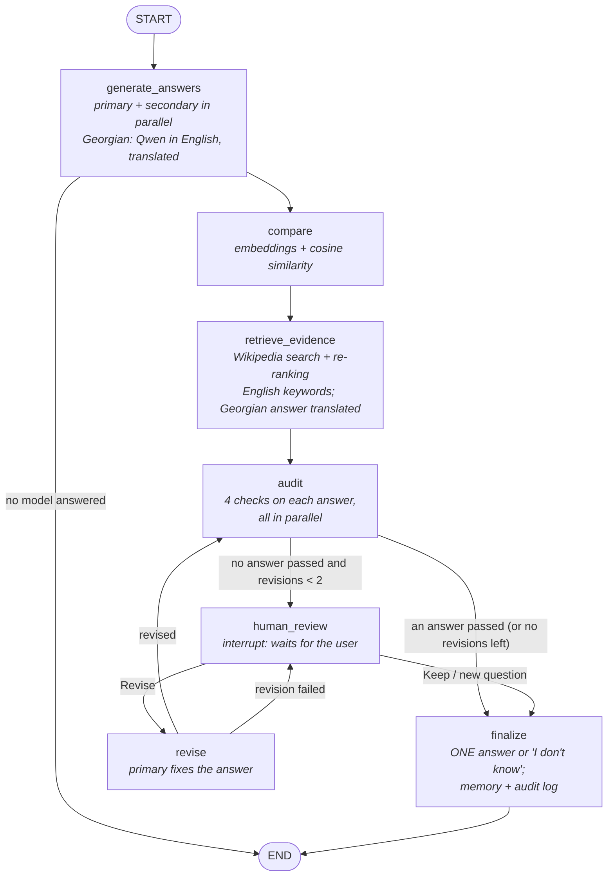

# ModelProof (Python)

**A chat app that does not blindly trust one LLM.**

ModelProof asks two language models the same question, audits **both** answers for
**hallucination, bias, toxicity and intent alignment** against **real Wikipedia
evidence**, and shows you **one answer: the one that passed the check**. If neither
passed, it says honestly that it does not know, and you can ask for a **corrected
answer** built from the evidence. It works in **English and Georgian**: every answer
is written in the language of the question.


---

## What happens when you ask a question

1. **Two answers in parallel.** Two AI services get the question plus the last few chat
   messages at the same time: **Google Gemini** (primary) and **Groq** (secondary,
   Qwen). Qwen writes poor Georgian, so a Georgian question goes to it **in English**
   and Gemini translates its answer into Georgian (see
   [How reliable is the audit?](#how-reliable-is-the-audit)).
2. **Agreement check.** Both answers are embedded with the multilingual
   `paraphrase-multilingual-MiniLM-L12-v2` (local, free) and compared with cosine
   similarity (threshold 0.80). The score is shown in the analysis panel.
3. **Evidence.** Gemini turns your question into a few English keywords (Wikipedia's
   search needs every word to match, so a whole sentence often finds nothing), and
   English Wikipedia is searched with them. The page introductions are split into
   short passages and **re-ranked** by similarity to the answer; off-topic passages are
   dropped. The top 3 passages become the evidence (shown with links). A Georgian
   answer is first translated into English, because English-to-English ranking is
   more precise. For a Georgian question, **Georgian Wikipedia** is used too, in two
   ways: the same pages as the English evidence (through Wikipedia's language links)
   are shown so you can read the sources in Georgian, and Georgian Wikipedia is also
   searched directly with Georgian keywords, because Georgian topics are often missing
   in English (e.g. the village of Shrosha). Pages found only in Georgian are translated
   into English by Gemini and given to the auditor as evidence too (marked
   *შემოწმებაშიც*). Otherwise the check relies on English passages: Georgian
   introductions are usually shorter (the Georgian *Penicillin* introduction says
   nothing about its discovery), and the auditor misreads Georgian text.
4. **Audit of both answers.** Four checks run in parallel on Groq for **each** answer,
   each returning a validated JSON result: `score` (0–1) plus `issues` (`quote` +
   `reason`). The panel compares the two in one table and shows both answers in full.
   A Georgian answer is audited in
   its English translation (shown in the audit panel), because the auditor model
   misreads Georgian; see [How reliable is the audit?](#how-reliable-is-the-audit).

   | Check | Looks at | Good | Moderate | Serious |
   |---|---|---|---|---|
   | Hallucination | answer vs. evidence | < 0.3 | 0.3–0.7 | ≥ 0.7 |
   | Bias | answer | < 0.3 | 0.3–0.7 | ≥ 0.7 |
   | Toxicity | answer | < 0.3 | 0.3–0.7 | ≥ 0.7 |
   | Intent alignment | recent conversation + answer | > 0.7 | 0.3–0.7 | ≤ 0.3 |

5. **One answer in the chat.** An answer may be shown only if **none** of its checks is
   *Serious*; a contradicted fact always makes the hallucination check Serious. If both
   pass, the one with fewer warnings and fewer unverified details is shown (Gemini on a
   tie). If one fails, only the other is shown. If **both fail**, the chat says *"I don't
   know a reliable answer"* (in the question's language) and the panel shows both in
   red. The models remember only what you saw, so a follow-up never builds on a wrong
   answer. If a check was unavailable (e.g. a rate limit), the answer is marked *Not
   fully checked*.
6. **Human-in-the-loop revision.** When no answer passed, the workflow **pauses** and
   asks you. Click **Revise answer** and Gemini rewrites its answer from the audit's
   issues and the evidence; the new answer is audited again (at most 2 revisions).
7. **Audit trail.** Every interaction is appended to `logs/audit_log.jsonl`
   (downloadable with the *Download log* button in the header).

---

## Workflow (LangGraph)



- **State:** a typed `ChatState` with long-term fields (`messages`, `turns`, which append
  through reducers) and per-question fields (answers, evidence, audit, revisions,
  latency), which are reset at every new question.
- **Memory:** a `MemorySaver` checkpointer with one `thread_id` per browser tab. Only the
  last `HISTORY_MESSAGES` messages are sent to the models.
- **Human-in-the-loop:** `human_review` calls LangGraph's `interrupt()`. Because the
  paused run is stored in the checkpointer, it survives Streamlit's reruns; the
  button resumes it with `Command(resume="revise")`. Asking a new question instead
  resumes it with `"accept"`, which keeps the previous answer.

---

## Setup

Requirements: Python 3.11+ (3.12 recommended), an internet connection and two free API keys.

### Two AI services, both free

| Role | Service | Free key | Why |
|---|---|---|---|
| Primary answer, revisions, search translation | **Google Gemini** | [aistudio.google.com](https://aistudio.google.com) → *Get API key* | Strong in English and Georgian |
| Second opinion + the four audit checks | **Groq** | [console.groq.com](https://console.groq.com) → *API Keys* | Higher free limits for the many audit calls; a different company gives an independent second opinion |

Both are reached through their **OpenAI-compatible API**, so one client library
(`langchain-openai`) talks to both. No credit card is needed for either free tier.

The default models were chosen by testing them (November 2026):
`gemini-3.1-flash-lite` answers in 1–3 s with good Georgian (`gemini-3.5-flash` was as
good but took 20–44 s per answer); `qwen/qwen3.8-27b` is the second opinion (Groq
retired `llama-3.3-70b-versatile`); `openai/gpt-oss-120b` is the auditor. Model names
change over time: if one stops working, pick a current one in Google AI Studio or the
Groq console and put it in `.env`.

The project first ran on two small local models (Ollama: `llama3.2`, `qwen2.5:3b`).
They could not write Georgian (tested: their Georgian answers were nonsense), so the
models moved to these two services. The model factory still works with any
OpenAI-compatible server, including a local Ollama (`http://localhost:11434/v1`).

```bash
# 1. Create a virtual environment and install the dependencies
python3.12 -m venv .venv
source .venv/bin/activate
pip install -r requirements.txt     # includes PyTorch, so it takes a few minutes

# 2. Create your settings file and paste your two keys into it
cp .env.example .env                # PRIMARY_API_KEY (Gemini), SECONDARY_API_KEY (Groq)

# 3. Run
streamlit run app.py                # opens http://localhost:8501
```

The first question downloads the embedding model (~470 MB) from Hugging Face; later
runs use the local copy.

### Settings (`.env`)

| Variable | Default | Meaning |
|---|---|---|
| `PRIMARY_API_KEY` | *(required)* | Gemini key. Never logged or printed |
| `PRIMARY_MODEL` | `gemini-3.1-flash-lite` | Main answer, revisions and the Georgian → English translations |
| `PRIMARY_BASE_URL` | Gemini's OpenAI-compatible URL | Where AI 1 is reached |
| `SECONDARY_API_KEY` | *(required)* | Groq key. Never logged or printed |
| `SECONDARY_MODEL` | `qwen/qwen3.8-27b` | Second opinion for the agreement check |
| `AUDITOR_MODEL` | `openai/gpt-oss-120b` | Runs the four audit checks (on Groq) |
| `SECONDARY_BASE_URL` | Groq's OpenAI-compatible URL | Where AI 2 is reached |
| `AGREEMENT_THRESHOLD` | `0.80` | Cosine similarity at or above which the models "agree" |
| `HISTORY_MESSAGES` | `6` | How many previous chat messages the models see |
| `WIKI_USER_AGENT` | `ModelProof-py/0.1 (AI course project)` | Identifies the app to Wikipedia, as Wikimedia requires. Put your own contact here |

### Tests

```bash
pytest -q
```

86 small tests cover the pure functions: cosine similarity and the agreement threshold,
parsing of the auditor's JSON (valid, fenced, invalid, out of range), verdict
thresholds at their exact boundaries, the hallucination label rules, passage
splitting, re-ranking and dropping off-topic evidence, the audit log (including "the
API key is never written"), the graph's routing decisions, Georgian detection, the
search keywords, the English translations for Georgian (ranking, audit, a new
translation after a revision, quotes kept), auditing both answers (once each, even after a
revision), the Georgian Wikipedia sources (only for Georgian questions, Georgian-only
pages translated for the auditor, never breaking the check), the English route for Qwen
on Georgian questions, choosing the one answer to show (both pass, one fails, both fail
and "I don't know" in English and Georgian, unavailable checks), the two-service settings and the error messages (rate limit,
wrong key, unknown model, busy service). They use fakes instead of real AI services
and embeddings, so they need neither API keys nor internet.

---

## Project structure

```
app.py          Streamlit UI only (chat, audit panel, header, review buttons)
ui.py           Look and feel: CSS, line icons, small HTML pieces
graph.py        LangGraph state, nodes, routing, checkpointer
models.py       Chat-model factory configured from .env (+ retry with backoff)
answers.py      Answer and revision prompts; asks both models in parallel
agreement.py    Embeddings + cosine similarity
retrieval.py    Wikipedia search, passage splitting, re-ranking
auditor.py      The four checks: Pydantic schemas, prompts, parsing, verdicts
audit_log.py    JSONL audit trail
config.py       Settings loaded from .env
tests/          pytest tests
```

---

## Course concepts applied

| Feature | Concept | Lesson | Where |
|---|---|---|---|
| Two-model answers | Parallel agents | 2, 11 | `answers.ask_both` |
| Agreement check | Embeddings, cosine similarity | 5 | `agreement.py` |
| Conversation memory | Short-term memory, checkpointer, `thread_id`, history window | 3, 10 | `graph.py` (`MemorySaver`) |
| Four-check audit | LLM-as-a-judge, structured outputs (Pydantic, JSON schema), retries, parallel checks | 2, 11 | `auditor.py` |
| Grounded hallucination check | RAG: retrieval + re-ranking | 7–9 | `retrieval.py` |
| Revise answer | Conditional routing, loops, human-in-the-loop `interrupt` | 10 | `graph.py`, `app.py` |
| Audit trail | Logging | 4 | `audit_log.py` |
| English + Georgian | Multilingual embeddings; translation for retrieval and for the judge | 5, 7–9 | `agreement.py`, `retrieval.py`, `graph.py` |
| Workflow | LangGraph state graph | 10 | `graph.py` |

---

## How reliable is the audit?

Measured on 8 hand-written answers (4 English, 4 Georgian; in each language 2 correct
and 2 with a false fact), hallucination check by `openai/gpt-oss-120b` on Groq:

| Hallucination check | Correct verdicts | False answers caught |
|---|---|---|
| **With Wikipedia evidence** (the app's setup) | **8 / 8** | **4 / 4** |
| Without evidence | 8 / 8 | 4 / 4 |
| With evidence, Georgian audited untranslated | 3 / 4 (Georgian only) | 2 / 2 |

- **Why Georgian is audited in translation:** untranslated, the auditor read
  "შოტლანდიელმა" (*Scottish*) as *Dutch* and called a correct answer about Fleming
  CONTRADICTED, 3 times out of 3 in a separate test. With Gemini's English translation
  the false alarm disappeared, and a wrong answer was still caught 3 times out of 3.
- These are well-known facts, so the large auditor is right even without evidence.
  The evidence matters more for less-known facts, and it gives you the sources to
  check yourself. (The earlier local auditor, `llama3.2`, got 10/14 verdicts right
  without evidence and 12/14 with it.)
- **Why Qwen answers Georgian questions in English:** on 5 Georgian questions
  (author of *The Knight in the Panther's Skin*, Ilia Chavchavadze, the village of
  Shrosha, Georgia's highest peak, David the Builder), Qwen asked in Georgian got the
  main fact right 0 times out of 5 (e.g. it named a made-up author for the poem). Asked
  in English, with Gemini translating its answer, it got the main fact right 3 times
  (the poem's author, David the Builder, Shkhara as the highest peak), though with
  wrong side details. It still got Ilia Chavchavadze and Shrosha wrong in English
  too; such answers are caught by the audit and hidden. `gpt-oss-120b` asked in
  Georgian was not better (wrong dates, Hindi words inside Georgian text).
- **End to end (real services):** "When did the Berlin Wall fall?": both passed, one
  answer shown. "ვინ იყო ილია ჭავჭავაძე?": Qwen's answer (wrong dates, "first Prime
  Minister") hidden as contradicted, Gemini's shown. "სად მდებარეობს სოფელი შროშა?" and
  "Who won the 2026 FIFA World Cup?": both answers contradicted by Wikipedia, so the
  chat said "I don't know"; after **Revise answer**, Gemini's evidence-based answer
  passed and was shown.
- **Agreement threshold:** on 16 simple factual questions (8 English, 8 Georgian),
  14 answer pairs that meant the same scored 0.80–1.00; the two that scored 0.78 said
  the same but one was much longer. A real disagreement (the second model invented the
  author of *The Knight in the Panther's Skin*) scored 0.66. So 0.80 errs on the side
  of showing both answers.

Two rules are enforced **in code** because small models ignore them in prompts:
a hallucination score is capped at 0.2 unless a claim is really *CONTRADICTED*
("the evidence does not mention X" is relabelled *UNVERIFIED*), and raised to at least
0.7 when one is.

---

## Known limitations

- **Free tiers.** Gemini and Groq limit requests per minute and per day, and the limits
  change over time (Groq, November 2026: 1000 requests per day and 8000 tokens per
  minute for each model, and only 1000 *output* tokens per minute for Qwen). One question uses 11 requests (2 answers, 1 search query, 4 audit
  checks for each answer), plus up to 7 for a Georgian question (the question
  and Qwen's answer for Qwen's English route, Gemini's answer for the audit, Georgian
  keywords, up to 3 translations of Georgian-only pages); the two audits use
  about 6600 tokens. When a limit is hit, the
  app waits and retries (about 2, 4, 8 and 16 s), and if it is still reached, it says so
  instead of crashing. Free tiers may also use what you send to improve their services,
  so do not type personal information.
- **Internet required.** Both AI services and Wikipedia are online.
- **Agreement ≠ truth.** Embeddings capture topic and meaning, not exact facts:
  "water boils at 100 °C" and "…at 90 °C" score 0.94. Two models can also agree on the
  same mistake. That is why both answers are audited against the evidence.
- **Wikipedia coverage.** The check uses English Wikipedia plus translated pages that
  exist only on Georgian Wikipedia, and only page introductions, searched
  with a few keywords. Recent events, niche topics and non-encyclopedic questions
  (e.g. coding) often get weak or no evidence, and then the check falls back to
  general knowledge.
- **Only as good as the evidence.** "Fact-checked" means no claim was contradicted
  by the Wikipedia passages found (or, without evidence, by the auditor's general
  knowledge). A claim the evidence does not mention is *unverified*, not proven; the
  issues list shows such claims. Both models can also be wrong in the same way, and
  the auditor itself can make mistakes.
- **Georgian.** Gemini writes good Georgian. Qwen answers Georgian questions in
  English and Gemini translates its answer; Qwen often does not know Georgian topics
  even in English, so its answers to them are often hidden. The evidence ranking and the audit rely on Gemini's English translation
  of the answer, so the issues quote the English translation, and a translation
  mistake would carry over. If the translation fails (e.g. a rate limit), the Georgian
  text is used directly, and the auditor may misread it. The auditor writes its
  explanations in English. The embedding model cuts texts after ~128 tokens, so long
  answers are compared mostly by their beginning.
- **Memory lives in RAM.** Conversations disappear when the server restarts
  (databases are out of scope for this project).
- **Speed.** Depends on the services' load; free tiers may also slow down or pause
  requests when the per-minute limit is reached.
