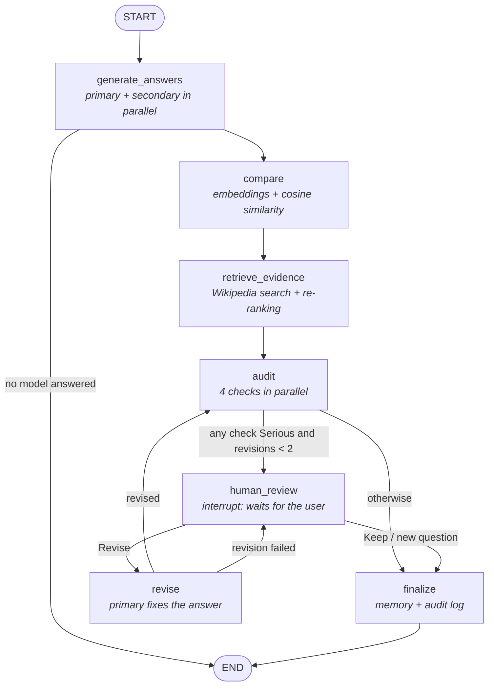

# ModelProof (Python)

**A chat app that does not blindly trust one LLM.**

ModelProof asks two language models the same question, measures whether they agree,
audits the answer for **hallucination, bias, toxicity and intent alignment**, grounds the
hallucination check in **real Wikipedia evidence**, and lets you ask for a **corrected
answer** when the audit finds a serious problem.

This is a from-scratch Python rebuild of
[ModelProof](https://github.com/hgenix20/modelproof), originally a TypeScript/React app
and a category winner of the Microsoft AI Agents Hackathon 2025. It was built as an
AI course project: every feature applies a concept from the course (see
[Course concepts applied](#course-concepts-applied)).

---

## What happens when you ask a question

1. **Two answers in parallel.** `llama3.2` (primary) and `qwen2.5:3b` (secondary) get the
   question plus the last few chat messages at the same time.
2. **Agreement check.** Both answers are embedded with `all-MiniLM-L6-v2` and compared
   with cosine similarity. At or above the threshold (default 0.80) you see the primary
   answer with a *models agree* badge; below it you see both answers side by side
   with a *models disagree* badge. The score is always shown.
3. **Evidence.** Wikipedia is searched with your question; the page introductions are
   split into short passages and **re-ranked** by similarity to the answer. The top 3
   passages become the evidence (shown with links).
4. **Audit.** Four checks run in parallel, each returning a validated JSON result:
   `score` (0–1) plus `issues` (`quote` + `reason`).

   | Check | Looks at | Good | Moderate | Serious |
   |---|---|---|---|---|
   | Hallucination | answer vs. evidence | < 0.3 | 0.3–0.7 | ≥ 0.7 |
   | Bias | answer | < 0.3 | 0.3–0.7 | ≥ 0.7 |
   | Toxicity | answer | < 0.3 | 0.3–0.7 | ≥ 0.7 |
   | Intent alignment | recent conversation + answer | > 0.7 | 0.3–0.7 | ≤ 0.3 |

5. **Human-in-the-loop revision.** If any check is *Serious*, the workflow **pauses** and
   asks you. Click **Revise answer** and the primary model rewrites the answer using the
   audit's issues and the evidence; the new answer is audited again (at most 2
   revisions). The original and revised answers are shown side by side.
6. **Audit trail.** Every interaction is appended to `logs/audit_log.jsonl`
   (downloadable with the *Download log* button in the header).

---

## Workflow (LangGraph)



- **State:** a typed `ChatState` with long-term fields (`messages`, `turns`, which append
  through reducers) and per-question fields (answers, evidence, audit, revisions,
  latency), which are reset at every new question.
- **Memory:** a `MemorySaver` checkpointer with one `thread_id` per browser tab. Only the
  last `HISTORY_MESSAGES` messages are sent to the models.
- **Human-in-the-loop:** `human_review` calls LangGraph's `interrupt()`. Because the
  paused run is stored in the checkpointer, it survives Streamlit's reruns; the
  button resumes it with `Command(resume="revise")`. Asking a new question instead
  resumes it with `"accept"`, which keeps the previous answer.

---

## Setup

Requirements: Python 3.11+ (3.12 recommended) and [Ollama](https://ollama.com).

```bash
# 1. Get the models (runs locally, free, no API key)
ollama pull llama3.2
ollama pull qwen2.5:3b

# 2. Create a virtual environment and install the dependencies
python3.12 -m venv .venv
source .venv/bin/activate
pip install -r requirements.txt     # includes PyTorch, so it takes a few minutes

# 3. Create your settings file
cp .env.example .env                # then set WIKI_USER_AGENT to your own contact

# 4. Run
streamlit run app.py                # opens http://localhost:8501
```

The first question downloads the embedding model (~90 MB) from Hugging Face; later runs
use the local copy.

### Settings (`.env`)

| Variable | Default | Meaning |
|---|---|---|
| `MODEL_PROVIDER` | `ollama` | LangChain provider for all models (`ollama`, or e.g. `openai` for an OpenAI-compatible API after `pip install langchain-openai`) |
| `MODEL_BASE_URL` | `http://localhost:11434` | Where the models run (`https://ollama.com` for Ollama Cloud) |
| `MODEL_API_KEY` | *(empty)* | Only needed for hosted providers. Never logged or printed |
| `PRIMARY_MODEL` | `llama3.2` | Gives the main answer and writes revisions |
| `SECONDARY_MODEL` | `qwen2.5:3b` | Second opinion for the agreement check |
| `AUDITOR_MODEL` | *(empty = primary)* | Runs the four audit checks |
| `AGREEMENT_THRESHOLD` | `0.80` | Cosine similarity at or above which the models "agree" |
| `HISTORY_MESSAGES` | `6` | How many previous chat messages the models see |
| `WIKI_USER_AGENT` | `ModelProof-py/0.1 (AI course project)` | Identifies the app to Wikipedia, as Wikimedia requires. Put your own contact here |

### Tests

```bash
pytest -q
```

48 small tests cover the pure functions: cosine similarity and the agreement threshold,
parsing of the auditor's JSON (valid, fenced, invalid, out of range), verdict
thresholds at their exact boundaries, the hallucination label rules, passage
splitting and re-ranking, the audit log (including "the API key is never written"),
and the graph's routing decisions. They use fake embeddings, so they need neither
Ollama nor internet.

---

## Project structure

```
app.py          Streamlit UI only (chat, audit panel, header, review buttons)
ui.py           Look and feel: CSS, line icons, small HTML pieces
graph.py        LangGraph state, nodes, routing, checkpointer
models.py       Chat-model factory configured from .env (+ retry with backoff)
answers.py      Answer and revision prompts; asks both models in parallel
agreement.py    Embeddings + cosine similarity
retrieval.py    Wikipedia search, passage splitting, re-ranking
auditor.py      The four checks: Pydantic schemas, prompts, parsing, verdicts
audit_log.py    JSONL audit trail
config.py       Settings loaded from .env
tests/          pytest tests
```

---

## Course concepts applied

| Feature | Concept | Lesson | Where |
|---|---|---|---|
| Two-model answers | Parallel agents | 2, 11 | `answers.ask_both` |
| Agreement check | Embeddings, cosine similarity | 5 | `agreement.py` |
| Conversation memory | Short-term memory, checkpointer, `thread_id`, history window | 3, 10 | `graph.py` (`MemorySaver`) |
| Four-check audit | LLM-as-a-judge, structured outputs (Pydantic, JSON schema), retries, parallel checks | 2, 11 | `auditor.py` |
| Grounded hallucination check | RAG: retrieval + re-ranking | 7–9 | `retrieval.py` |
| Revise answer | Conditional routing, loops, human-in-the-loop `interrupt` | 10 | `graph.py`, `app.py` |
| Audit trail | Logging | 4 | `audit_log.py` |
| Workflow | LangGraph state graph | 10 | `graph.py` |

---

## How reliable is the audit?

Measured on 7 hand-written answers (4 correct, 3 with a false fact), each audited twice
by `llama3.2`:

| Hallucination check | Correct verdicts | False answers caught |
|---|---|---|
| Without evidence | 10 / 14 | 3 / 3 |
| **With Wikipedia evidence** | **12 / 14** | **3 / 3** |
| With evidence, `qwen2.5:7b` as auditor | 12 / 14 | 3 / 3 (about 3× slower) |

Two rules are enforced **in code** because small models ignore them in prompts:
a hallucination score is capped at 0.2 unless a claim is really *CONTRADICTED*
("the evidence does not mention X" is relabelled *UNVERIFIED*), and raised to at least
0.7 when one is.

---

## Known limitations

- **Small models (~3B).** The auditor sometimes flags the wrong check (e.g. a factual
  error also scored as "toxic") or calls a correct claim contradicted. Pointing
  `AUDITOR_MODEL` at a stronger model is a one-line change in `.env`.
- **Agreement ≠ truth.** Embeddings capture topic and meaning, not exact facts:
  "water boils at 100 °C" and "…at 90 °C" score 0.94. Two models can also agree on the
  same mistake. That is why the audit and the evidence exist.
- **Wikipedia coverage.** Only English Wikipedia, only page introductions, searched
  with the question text. Recent events, niche topics and non-encyclopedic questions
  (e.g. coding) often get weak or no evidence, and then the check falls back to
  general knowledge.
- **English only.** `all-MiniLM-L6-v2` is trained on English and truncates long texts
  (~256 tokens), so long answers are compared mostly by their beginning.
- **Memory lives in RAM.** Conversations disappear when the server restarts
  (databases are out of scope for this project).
- **Speed.** On a laptop one question takes roughly 15–40 s (two answers, four audit
  checks, optional revisions). Ollama may run parallel requests one after another.

---

## Original project

TypeScript/React version (Microsoft AI Agents Hackathon 2025, JavaScript/TypeScript
category winner): <https://github.com/hgenix20/modelproof>
